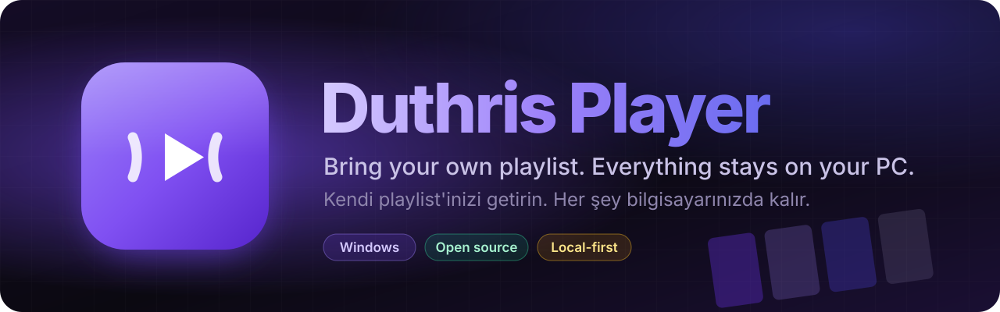
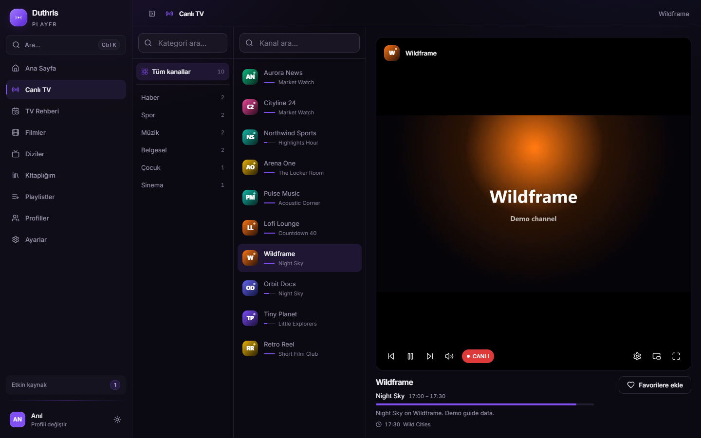
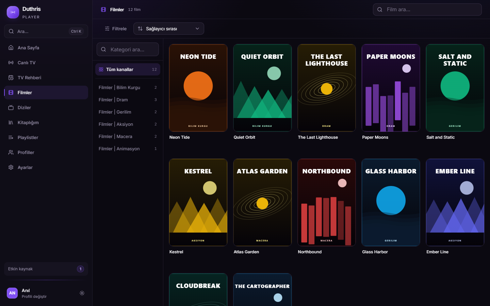
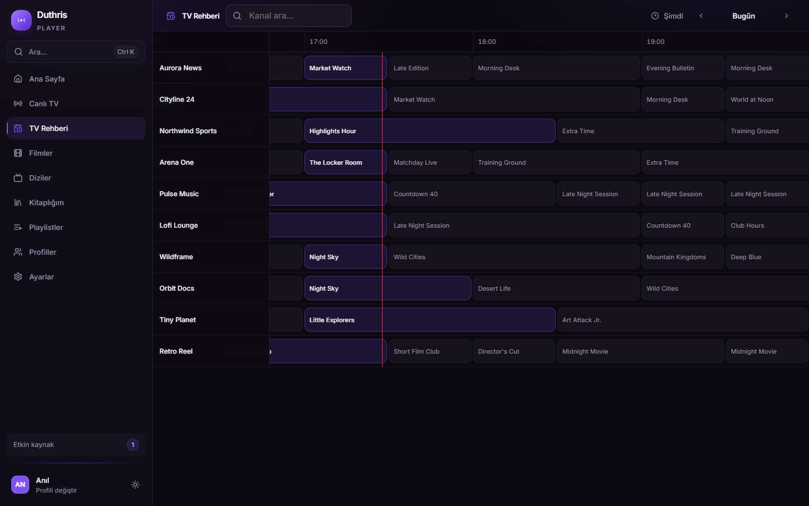
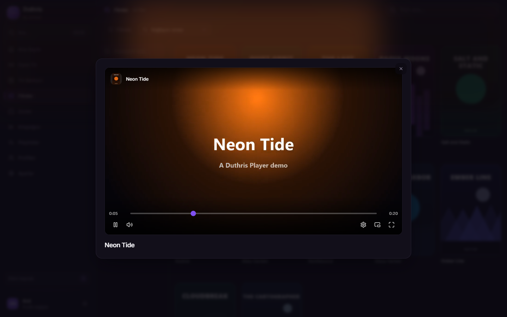
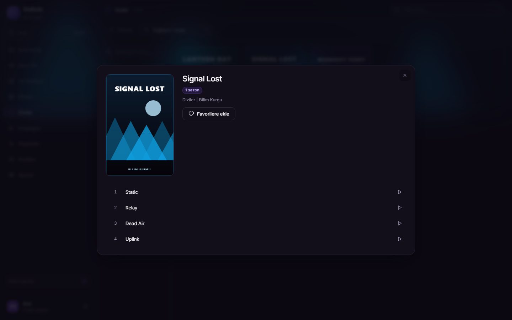
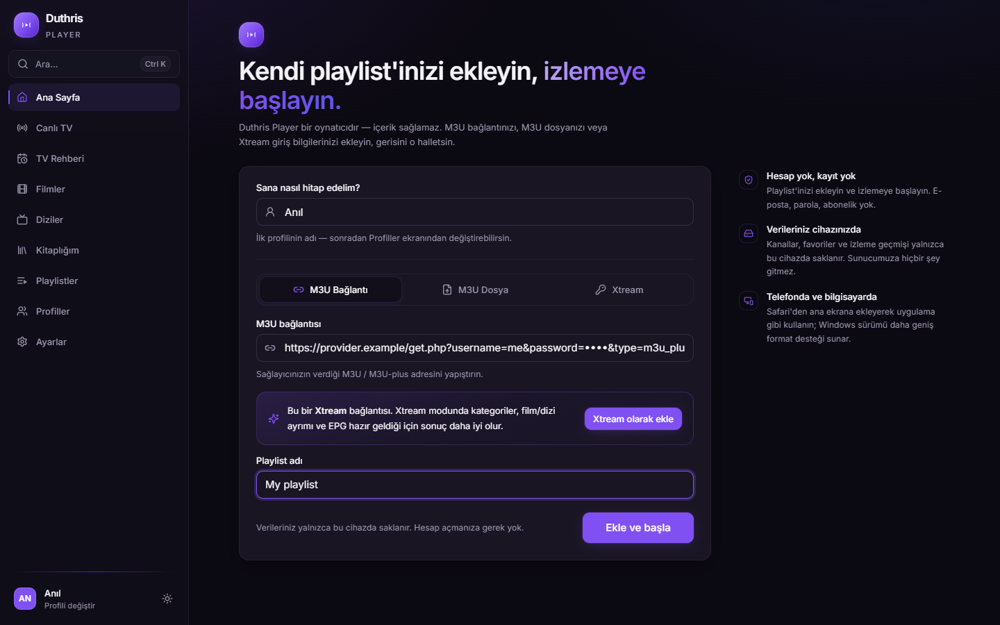

<div align="center">



<br>

[](https://github.com/Duthris/duthris-player/releases/latest)
[](https://github.com/Duthris/duthris-player/releases)
[](#-kurulum)
[](LICENSE)
[](https://github.com/Duthris/duthris-player/actions/workflows/ci.yml)

[English](README.md) · **Türkçe**

**Kendi M3U ve Xtream playlist'leriniz için yerel bir oynatıcı.** Rehberli canlı TV, posterli ve kaldığı yerden<br>
devam eden filmler ve diziler, tarayıcının oynatamadığı formatlar. Hesap yok, sunucu yok, içerik yok.

<a href="https://github.com/Duthris/duthris-player/releases/latest"></a>

</div>

<br>

<table align="center">
  <tr>
    <td align="center"><br><sub><b>Canlı TV</b>, şimdi ve sırada</sub></td>
    <td align="center"><br><sub><b>Film ve diziler</b> poster ızgarasında</sub></td>
    <td align="center"><br><sub><b>TV rehberi</b> zaman çizelgesinde</sub></td>
  </tr>
</table>

> [!NOTE]
> Duthris Player bir oynatıcıdır. Kanal, playlist ya da yayın içermez ve hiçbir zaman içermeyecek. Sağlayıcınızın size verdiği playlist'i eklersiniz, uygulama onu oynatır. Ekran görüntülerindeki kütüphane tamamen uydurma bir demodur.

## ✨ Neler yapar

| | |
| --- | --- |
| 📺 **Canlı TV** | Kategoriler, arama, rehber bilgisiyle kanal listesi, numarayla kanal açma, önceki/sonraki ve son kanala dönüş. Birçok kanal yalnızca birini sunduğu için HLS'ten ham MPEG-TS'e kendiliğinden geçer. |
| 🎬 **Film ve diziler** | On binlerce başlıkta bile hızlı kalan poster ızgaraları, kaldığı yerden devam, otomatik sonraki bölüm, sıralama ve filtreleme. Eksik posterler ve açıklamalar TMDB'den tamamlanır. |
| 🗓️ **TV rehberi** | Kanal adlarını esnek eşleştiren XMLTV içe aktarma, kaydırılabilir zaman çizelgesi, gün gün gezinme, saat dilimi düzeltmesi ve program başlamadan hatırlatma. XMLTV yoksa panelin kendi rehberini kullanır. |
| 🎞️ **Tarayıcının oynatamadığını oynatır** | MKV ve AVI, AC-3, E-AC-3 ve DTS ses, gömülü FFmpeg ile anında dönüştürülür. Görüntü mümkün olduğunca kopyalanır, çoğu zaman yalnızca ses çevrilir. |
| 💬 **Altyazı** | Gömülü altyazılar, kendi `.srt` / `.vtt` / `.ass` dosyalarınız ya da oynatıcının içinden OpenSubtitles araması. Görünüm ve gecikme ayarlanabilir. |
| 🧑‍🤝‍🧑 **Profiller** | Her kişiye ayrı favoriler, geçmiş ve izlemeye devam, isteğe bağlı PIN ve yalnızca seçilen playlist'leri gören profiller. |
| 📥 **Çevrimdışı ve arşiv** | Film ve bölümleri sonra izlemek için diske indirin, panel destekliyorsa arşivden geriye dönük izleyin. |
| 🎛️ **Oynatıcı** | Kalite ve ses dili seçimi, en-boy oranı, hız, uyku zamanlayıcısı, resim içinde resim, medya tuşları ya da yayını mpv veya VLC'ye aktarma. |
| 🔄 **Kendini günceller** | Yeni sürümler arka planda iner, bir sonraki açılışta kurulur. Windows ile başlayıp bildirim alanında bekleyebilir. |

<table align="center">
  <tr>
    <td align="center"><br><sub><b>Oynatıcı</b>, her format</sub></td>
    <td align="center"><br><sub><b>Diziler</b> sezon ve bölümlerle</sub></td>
    <td align="center"><br><sub><b>Tek form</b> ile playlist ekleme</sub></td>
  </tr>
</table>

## 📥 Kurulum

1. [Son sürümden](https://github.com/Duthris/duthris-player/releases/latest) indirin:
   - **`Duthris-Player-x.y.z-x64.exe`**: kurulum dosyası. Önerilen; **kendini günceller**.
   - **`Duthris-Player-x.y.z-portable.exe`**: tek dosya, kurulum gerektirmez.
2. Çalıştırın, M3U bağlantınızı, M3U dosyanızı ya da Xtream bilgilerinizi ekleyin ve izlemeye başlayın.
3. İsterseniz TV rehberini **Playlistler → TV rehberini indir** ile indirin.

> [!NOTE]
> Dosyalar henüz kod imzalı değil, bu yüzden Windows SmartScreen *"Windows bilgisayarınızı korudu"* diyebilir. **Ek bilgi → Yine de çalıştır**'a tıklayın. Her sürüm bu depodan [GitHub Actions](https://github.com/Duthris/duthris-player/actions/workflows/release.yml) ile derlenir.

> [!TIP]
> Uygulamanın adı 1.10'a kadar **Duthris IPTV** idi. Kurulu sürümler yerinde güncellenir; profiller, playlist'ler ve geçmiş korunur.

## ❓ SSS

<details>
<summary><b>Playlist'i nereden bulurum?</b></summary>

Sağlayıcınızdan. Duthris Player hiçbir playlist satmaz, içermez ya da önermez; yalnızca sizin eklediğinizi oynatır.
</details>

<details>
<summary><b>Bir kanal açılmıyor ya da sessiz oynuyor</b></summary>

**Playlistler** ekranında o kaynak için diğer **Yayın protokolü**nü (HTTP / HTTPS) deneyin. Bazı paneller yalnızca tanıdığı oynatıcılara yanıt verir; oradaki **Kimlik (User-Agent)** alanı bunun için. Hâlâ olmuyorsa **Ayarlar → Günlükleri dışa aktar** ile günlüğü alıp bir issue açın.
</details>

<details>
<summary><b>macOS ya da tarayıcı sürümü var mı?</b></summary>

Bugün desteklenen platform Windows. Aynı uygulama web sürümü olarak da çalışır, ama tarayıcı MKV'yi açamaz, HTTPS sayfadan HTTP yayınlara ulaşamaz ve görsel sunucularındaki DNS engellerini aşamaz; o yüzden web sürümü elden geldiğince çalışır.
</details>

<details>
<summary><b>Başka bir bilgisayara nasıl taşırım?</b></summary>

**Ayarlar → Yedek oluştur** profillerinizi, playlist'lerinizi, favorilerinizi ve geçmişinizi şifreli bir dosyaya yazar. Diğer bilgisayarda **Yedekten geri yükle** ile açın.
</details>

## 🔒 Gizlilik

Hesap yok, telemetri yok, kendimize ait sunucu yok. Her şey (profiller, favoriler, izleme geçmişi, katalog) bilgisayarınızda kalır. Uygulama yalnızca şunlarla konuşur:

- playlist ve rehber sağlayıcınız;
- TMDB, eksik posterler ve açıklamalar için;
- OpenSubtitles, altyazı aradığınızda;
- YouTube (`youtube-nocookie.com`), bir fragman açtığınızda;
- Cloudflare ya da Google DNS-over-HTTPS, masaüstü uygulamasında ad çözümlemesi için;
- GitHub, güncellemeleri denetlemek için.

## 🛠️ Geliştirme

Node.js 22+ ve pnpm 11+ gerekir.

```sh
pnpm install
pnpm dev                          # http://localhost:3000 üzerinde web uygulaması
pnpm --filter @iptv/desktop dev   # ona bağlanan masaüstü kabuğu
pnpm -w run verify                # typecheck, lint, build, masaüstü dışa aktarımı
pnpm -w run package:win           # apps/desktop/release içinde NSIS kurulum ve portable exe
```

Bir `v*` etiketi göndermek GitHub Actions ile sürümü derleyip yayınlar; kurulu kopyalar otomatik güncelleyiciyle alır.

Bir derlemeye TMDB anahtarı gömmek için `apps/web/.env.example` dosyasını `apps/web/.env.local` olarak kopyalayın. Zorunlu değildir; anahtar ayarlar ekranına da yapıştırılabilir. İkonlar tek bir SVG'den üretilip depoya eklenir (`pnpm -w run icons`).

```
apps/web        Next.js uygulaması, masaüstü kabuğu için statik olarak dışa aktarılır
apps/desktop    Electron ana süreci, FFmpeg dönüştürme sunucusu, kimlik bilgisi deposu
packages/core   Framework'süz ayrıştırıcılar ve istemciler: M3U, XMLTV, Xtream, TMDB
packages/db     Dexie şeması ve depoları
packages/ui     Tasarım değişkenleri ve ortak bileşenler
packages/config TypeScript ve ESLint tabanları
```

Paketler `transpilePackages` ile kaynak olarak kullanılır. Web sürümündeki `/api/proxy` yalnızca metin ve JSON taşır (playlist'ler, XMLTV, Xtream API); video ve görselleri reddeder.

**Bilerek kapsam dışı:** herhangi bir yayını barındırmak ya da dağıtmak, videoyu bir sunucu üzerinden geçirmek, bulut senkronizasyonu, kayıt ve yansıtma.

## ⚖️ Yasal uyarı

> [!IMPORTANT]
> Duthris Player hiçbir medya, kanal ya da playlist içermez ve herhangi bir sağlayıcıyla bağlantısı yoktur. Eklediği içeriği izleme hakkına sahip olmak kullanıcının sorumluluğundadır. Proje, bilgi paylaşımı ve yazılım geliştirme eğitimi amacıyla açık kaynak bir platformda paylaşılmaktadır.

## 📄 Lisans

[MIT](LICENSE) © Duthris
